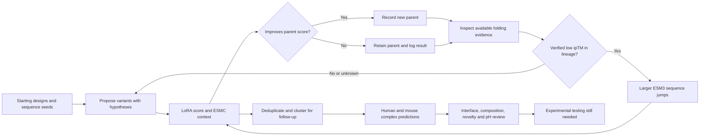

# Binder Iteration & Jump

Agent-guided sequence search for proposed human/mouse EGFR binders, combining local mutation rounds, larger sequence jumps, and independent computational review.

This repository condenses work from September 28–October 5, 2026. It documents the method and its changing settings; it is not an executable release of the private search engine or a claim of experimentally validated binding.

## The method in one paragraph

Starting from de novo EGFR designs and additional sequence-only seeds, separate GPT and DeepSeek agents proposed hypothesis-driven variants. A frozen human-EGFR LoRA classifier selected improving parents, while ESMC masked pseudo-perplexity supplied sequence context. Local substitutions were supplemented by ESM3 sequence-only jumps when verified folding evidence was poor. Candidates were deduplicated and clustered, and selected representatives were folded separately with human and mouse EGFR using ESMFold2 and Boltz. Interface inspection, composition checks, novelty screening, and exploratory pH calculations informed the final review. Binding, cross-species activity, and pH selectivity remain experimentally unverified.

The diagram summarizes the later jump policy. Earlier rounds had different rules; folding admission and final selection were separate stages.

## Read next

- [Form-ready method and configuration](submission-text.md)
- [Search rules and historical settings](METHOD.md)
- [Week in review and limitations](REVIEW.md)
- [Source artifact hashes and verified counts](provenance.json)

The October 3 export contains **9,166 records** across both arms, including baselines and archived pilot rows, and **322 accepted mutations**. These are search records, not 9,166 experimentally tested proteins or 322 confirmed binders.

## Scope

Only curated documentation and a provenance manifest are published here. Private sessions, credentials, infrastructure addresses, model weights, third-party textbooks, raw candidate sequences, and live ledgers are excluded. Reproducing the original campaign requires its private engine, checkpoints, inputs, and per-round receipts. No source-code or model redistribution rights are implied.

Upstream tools: [ESM / ESM3 / ESMC / ESMFold2](https://github.com/biohub/esm), [Boltz](https://github.com/jwohlwend/boltz), [PROPKA](https://github.com/jensengroup/propka).
